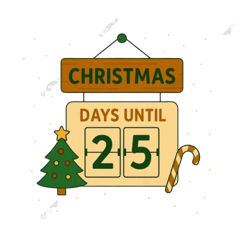

<div align="center">



# 🎄 Christmas Countdown

### How long until Santa arrives? Find out in real time.

[](https://christmas-countdown-omega.vercel.app/) 
[](https://angular.dev) [](https://www.typescriptlang.org) [](https://sass-lang.com) [](https://prettier.io) [](https://vercel.com) [](LICENSE)

</div>

---

## ✨ Features

- 🌟 **Cinematic intro** — a golden star bursts open and the page rises into view
- 🌌 **Living night scene** — twinkling stars, shooting stars, aurora, a glowing moon, a pine forest and a snowy village, with mouse parallax
- 🦌 **Santa's sleigh** — flies across the moon every ~40 seconds
- ❄️ **Canvas snowfall** — hundreds of flakes at different depths that drift in the wind and dodge the cursor
- 🕐 **Flip-clock countdown** — 3D split-flap days, hours, minutes and seconds, plus a "weeks and days" summary
- 🍭 **Santa's journey** — a candy-cane progress bar from last Christmas to the next
- 🎁 **Advent calendar** — 24 doors (unlocked through December) that each play a magic show on the scene: Santa fly-by, fireworks, snowstorm, meteor shower, northern lights, golden snow, party lights, supermoon, snow globe, confetti and a grand finale on the 24th
- ✨ **Click sparkles** — every click sends out a burst of gold sparkles
- 🎅 **Christmas Day mode** — "Merry Christmas" with non-stop fireworks
- 🌗 **Two themes** — *Winter night* and *Christmas Eve sunset*; the whole scene fades smoothly between them
- 💾 **Persistent** — theme and opened advent doors saved to `localStorage`
- ♿ **Reduced motion** — animations calm down when the OS asks for less motion
- 📱 **Fully responsive** — works on all screen sizes

> **Tip:** while running locally, open `http://localhost:4200/?peek` to unlock every advent door for previewing. Nothing is saved in preview mode, and it does nothing in production builds.

---

## 🛠️ Tech Stack

| | |
|---|---|
| **Framework** | Angular 21 — standalone components, signals, no Zone.js |
| **Language** | TypeScript 5.9 |
| **Styling** | SCSS + CSS custom properties for theming |
| **Icons** | Bootstrap Icons |
| **Formatting** | Prettier |
| **Hosting** | Vercel |

---

## 🚀 Getting Started

**Prerequisites:** Node.js 18+, npm 10+

```bash
# 1. Install dependencies
npm install

# 2. Start the dev server
npm start
```

Then open **http://localhost:4200/** in your browser.

### Available Scripts

| Command | Description |
|---|---|
| `npm start` | Start local dev server |
| `npm run build` | Production build → `dist/` |
| `npm run watch` | Build in watch mode |

---

## 📁 Project Structure

```
src/
├── app/                        # App shell (routing, config)
├── libs/
│   ├── components/
│   │   ├── advent-calendar/    # 🎁 24 doors that trigger magic shows
│   │   ├── fairy-lights/       # 💡 String of glowing bulbs
│   │   ├── flip-card/          # 🕐 3D split-flap digit card
│   │   ├── intro-overlay/      # 🌟 Opening star animation
│   │   ├── journey-bar/        # 🍭 Progress from last Christmas
│   │   ├── night-sky/          # 🌌 Sky, moon, aurora and landscape
│   │   ├── santa-sleigh/       # 🦌 Sleigh and reindeer (SVG)
│   │   ├── snowfall/           # ❄️ Canvas snow particles
│   │   └── sparkle-bursts/     # ✨ Click sparkles, fireworks, confetti
│   ├── constants/              # App-wide constants (scene shows, landscape, advent)
│   ├── directives/             # Tilt-on-hover
│   ├── helpers/                # Pure builder / calculation functions
│   ├── models/                 # TypeScript interfaces
│   ├── pages/
│   │   └── home/               # 🏠 Main countdown page
│   └── services/
│       ├── advent-calendar.service  # 🎁 Opened doors + preview mode
│       ├── countdown.service        # ⏱️ Timer logic (signals)
│       ├── scene-effects.service    # 🪄 Plays magic shows on the scene
│       └── theme.service            # 🎨 Winter night / Christmas Eve theme toggle
└── styles/
    └── tokens.scss             # CSS custom properties for both themes
```

---

## 📄 License

MIT — see [LICENSE](LICENSE) for details.

---

<div align="center">
  Built with ❤️ and a little Christmas magic 🎁
</div>
